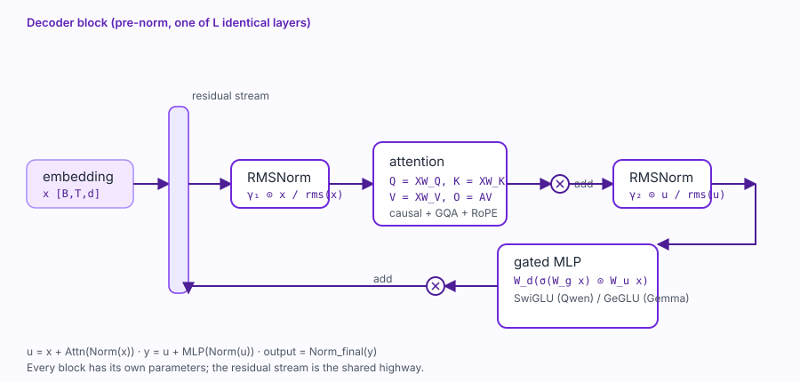
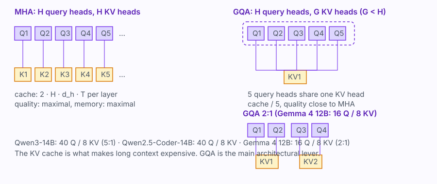
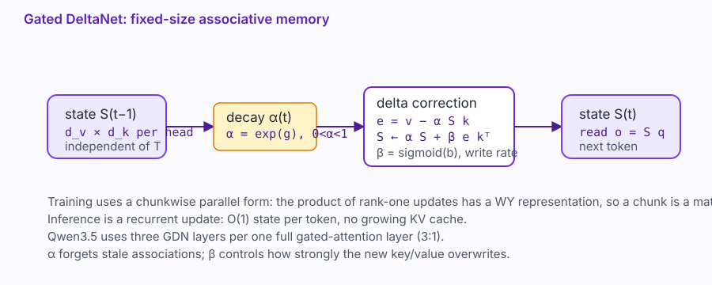
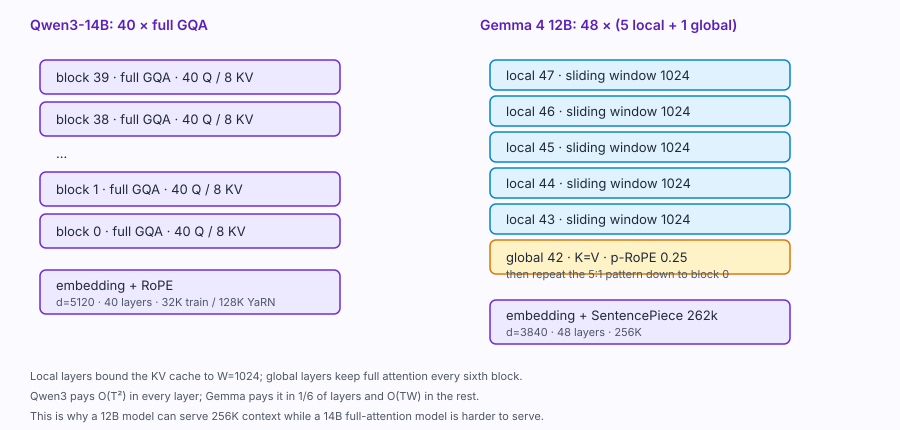

# 32 — The mathematics inside Qwen and Gemma 4

*Last verified: 27 October 2026. Equations are standard transformer/linear-attention math; model-specific numbers come from the Qwen3, Qwen2.5-Coder, Qwen3.5 and Gemma 4 technical reports cited at the end.*

This chapter is the common mathematical foundation for the next four. It explains what a decoder-only language model computes, why Qwen and Gemma choose different pieces, and how to count parameters, FLOPs, memory and KV cache.

It is deliberately equation-heavy. There are three companion pages:

- **[37 — Architecture anatomy](37-architecture.md)** maps every equation to actual tensor shapes and `config.json` keys.
- **[38 — Derivations and proofs](38-derivations.md)** proves the softmax gradient, the RoPE relative property, the RMSNorm Jacobian, the GDN recurrence and the quantization error bound.
- **[43 — Worked examples](43-math-examples.md)** runs every formula on a toy model with real numbers, so you can check the arithmetic yourself.
- **[35 — From zero](35-from-zero.md)** and **[36 — Reproducing 12B–14B](36-reproducing-12b-14b.md)** turn the math into a training plan.

If you only want the practical fine-tuning recipe, skip to [08 — Fine-tuning](08-finetuning.md).

---

## 0. Notation

| Symbol | Meaning |
|---|---|
| \(T\) | sequence length |
| \(V\) | vocabulary size |
| \(d\) | hidden size (model dimension) |
| \(L\) | number of transformer layers |
| \(H\) | number of query heads |
| \(G\) | number of key/value heads (GQA) |
| \(d_h\) | head dimension |
| \(d_{\text{ff}}\) | FFN intermediate size |
| \(N\) | parameter count |
| \(D\) | training tokens |
| \(\theta\) | all trainable parameters |
| \(x_t\) | token at position \(t\) |
| \(z_t\) | logits at position \(t\) |
| \(\eta\) | learning rate |
| \(\lambda\) | weight decay |
| \(b\) | bytes per value (2 for bf16, 1 for int8) |

A bold matrix is written \(W\); a vector is \(x\); \(\top\) is transpose; \(\odot\) is elementwise product; \(\sigma\) is the logistic sigmoid unless stated otherwise.

---

## 1. What “creating a model” means

A model like Qwen3-14B or Gemma 4 12B is the result of five coupled choices:

1. **Tokenization** — how text, code and multimodal inputs become integer sequences.
2. **Architecture** — what function \(f_\theta\) maps a token sequence to next-token probabilities.
3. **Objective** — what loss is minimised during pretraining.
4. **Data and optimisation** — what tokens are seen, in what order, with what schedule and precision.
5. **Post-training** — SFT, preference optimisation, RL and distillation that turn a base model into a usable assistant.

“From scratch” means learning \(\theta\) from random initialisation on a large corpus. Fine-tuning (including LoRA) starts from an existing \(\theta\) and is a different, much cheaper problem.

---

## 2. Tokenization

A tokenizer is a function

\[
\tau: \text{string} \rightarrow (x_1,\dots,x_T), \qquad x_t \in \{0,\dots,V-1\}.
\]

Qwen3 uses **byte-level BPE** with \(V=151{,}669\). Qwen2.5-Coder uses byte-level BPE with \(V=151{,}646\). Gemma 4 uses a **SentencePiece** tokenizer with \(V=262{,}144\), split digits, preserved whitespace and byte-level fallback.

The public Qwen3 report quotes 151,669 and Qwen2.5-Coder 151,646; the Hugging Face checkpoints pad the embedding to 151,936 and 152,064 respectively for tensor-parallel divisibility. The padding rows are unused but still cost memory.

### 2.1 BPE objective

Byte-pair encoding starts from bytes and repeatedly merges the most frequent adjacent pair:

\[
(a,b)^\* = \arg\max_{(a,b)} \operatorname{count}(a,b),
\qquad
\text{merge }(a,b)\rightarrow c.
\]

After \(M\) merges, the vocabulary is \(256+M\) (plus special tokens). The compression ratio is

\[
\rho = \frac{\text{bytes}}{\text{tokens}}.
\]

A higher \(\rho\) means cheaper training and inference per character, but a larger embedding matrix \(V d\) and a larger output softmax.

### 2.2 Why vocabulary size matters

The input embedding and output head cost

\[
P_{\text{emb}} = V d \quad\text{(tied)},\qquad
P_{\text{emb}} = 2 V d \quad\text{(untied)}.
\]

For Qwen3-14B, \(V=151{,}936\), \(d=5{,}120\), untied: \(2Vd\approx1.56\text{B}\) parameters — about 10.5% of the model. For Gemma 4 12B, \(V=262{,}144\), \(d=3{,}840\), tied: \(Vd\approx1.01\text{B}\).

The softmax denominator at every position costs \(V\) operations:

\[
p(x_{t+1}=j\mid x_{\le t}) =
\frac{\exp(z_j)}{\sum_{k=1}^{V}\exp(z_k)}.
\]

> **Worked example:** [43 §1–3](43-math-examples.md) computes the softmax, the CE and the gradient for \(z=(2,1,0,-1)\).

That is why a 262k vocabulary is expensive at inference even when the model is only 12B.

### 2.3 Special tokens

Chat and tool use need control tokens: BOS, EOS, turn separators, thinking delimiters, tool-call delimiters. Gemma 4 uses `<|turn>`, `<turn|>`, `<|tool>`, `<tool|>`, `<|tool_call>`, `<tool_call|>`, `<|channel>`, `<channel|>`. Qwen3 uses ChatML-style `<|im_start|>`, `<|im_end|>`, and `<tool_call>`. These tokens are part of the model’s contract; changing them after pretraining is a fine-tuning problem, not a formatting detail.

---

## 3. The autoregressive objective

A decoder-only model factorises the joint probability of a sequence:

\[
p_\theta(x_1,\dots,x_T) = \prod_{t=1}^{T} p_\theta(x_t\mid x_{<t}).
\]

The pretraining loss is the mean negative log-likelihood:

\[
\mathcal{L}_{\text{NLL}}(\theta)
= -\frac{1}{T}\sum_{t=1}^{T}\log p_\theta(x_t\mid x_{<t}).
\]

If the model outputs logits \(z_t\in\mathbb{R}^{V}\), then

\[
p_\theta(x_t\mid x_{<t}) = \operatorname{softmax}(z_t)_{x_t},
\]

and the per-token loss is the cross-entropy

\[
\ell_t = -z_{t,x_t} + \log\sum_{j=1}^{V}\exp(z_{t,j}).
\]

Perplexity is \(\exp(\mathcal{L}_{\text{NLL}})\). It is comparable only across models with the same tokenizer; a 262k SentencePiece model and a 151k BPE model can have very different per-token losses for the same text quality.

### 3.1 Masked / completion loss

For SFT, the prompt tokens are often masked:

\[
\mathcal{L}_{\text{SFT}} =
-\frac{1}{|\mathcal{C}|}\sum_{t\in\mathcal{C}}
\log p_\theta(x_t\mid x_{<t}),
\]

where \(\mathcal{C}\) is the completion span. This is exactly what `mask_prompt: true` does in MLX-LM: only the final assistant turn contributes. It does not make a multi-turn example train every turn; split trajectories if you need that.

---

## 4. The transformer block

A modern decoder block is a residual stack:

\[
\begin{aligned}
u &= x + \operatorname{Attn}(\operatorname{Norm}_1(x)),\\
y &= u + \operatorname{MLP}(\operatorname{Norm}_2(u)).
\end{aligned}
\]

Qwen3 and Qwen2.5 use **pre-norm** with RMSNorm. Gemma 4 uses **pre-norm and post-norm** with RMSNorm and QK-norm. Pre-norm keeps the residual path close to identity, which stabilises deep training; post-norm can improve final representation quality at the cost of stability.

The residual stream is the shared highway: every attention and MLP block reads from it and writes back to it. That is why all blocks have the same shape \(B\times T\times d\), and why LoRA can be inserted into projections without changing the interface. [37 — Architecture anatomy](37-architecture.md) traces the exact tensors for Qwen3-14B and Gemma 4 12B.

---

## 5. RMSNorm

LayerNorm is

\[
\operatorname{LN}(x) = \gamma \odot
\frac{x-\mu}{\sqrt{\sigma^2+\epsilon}},
\quad
\mu=\frac{1}{d}\sum_i x_i,
\quad
\sigma^2=\frac{1}{d}\sum_i (x_i-\mu)^2.
\]

RMSNorm drops the mean subtraction:

\[
\operatorname{RMSNorm}(x) = \gamma \odot
\frac{x}{\sqrt{\frac{1}{d}\sum_{i=1}^{d}x_i^2+\epsilon}}.
\]

It has one vector \(\gamma\in\mathbb{R}^d\) and no bias. [43 §4](43-math-examples.md) runs it on \(x=(1,2,3,4)\). Why it works: the residual stream’s scale is what matters, not its mean; removing the mean subtraction saves a reduction and a broadcast, and empirically trains stably. Qwen3, Qwen2.5 and Gemma 4 all use RMSNorm.

**QK-norm.** Qwen3 introduces QK-Norm to stabilise attention: normalise \(q\) and \(k\) per head before the dot product,

\[
\tilde q = \operatorname{RMSNorm}(q), \qquad
\tilde k = \operatorname{RMSNorm}(k).
\]

Gemma 4 also uses QKNorm. This bounds the attention logits and reduces loss spikes at large learning rates.

---

## 6. Scaled dot-product attention

For one head with query \(q\in\mathbb{R}^{d_k}\), keys \(K\in\mathbb{R}^{T\times d_k}\), values \(V\in\mathbb{R}^{T\times d_v}\):

\[
\operatorname{Attn}(q,K,V) =
\operatorname{softmax}\left(\frac{qK^\top}{\sqrt{d_k}}\right)V.
\]

For a whole sequence, with \(Q=XW_Q\), \(K=XW_K\), \(V=XW_V\):

\[
A = \operatorname{softmax}\left(
\frac{QK^\top}{\sqrt{d_k}} + M
\right),
\qquad
O = AV,
\]

where the causal mask is

\[
M_{ij} =
\begin{cases}
0, & j\le i,\\
-\infty, & j>i.
\end{cases}
\]

The \(\sqrt{d_k}\) scaling keeps the logits at unit variance if \(q,k\) have unit variance: \(\operatorname{Var}(q\cdot k)=d_k\). [43 §5](43-math-examples.md) runs one query against three keys, then the causal mask and a \(2\times2\) backward pass.

### 6.1 Multi-head attention

With \(H\) heads and head dimension \(d_h=d/H\):

\[
\operatorname{MultiHead}(X) =
\operatorname{Concat}(\text{head}_1,\dots,\text{head}_H)W_O,
\]

\[
\text{head}_h = \operatorname{Attn}(XW_Q^h, XW_K^h, XW_V^h).
\]

Each head can specialise: induction, syntax, copying, long-range retrieval.

### 6.2 Grouped-query attention (GQA)

GQA uses \(H\) query heads but only \(G\) key/value heads, with \(G<H\):

\[
Q\in\mathbb{R}^{H\times d_h},\quad
K,V\in\mathbb{R}^{G\times d_h},\quad
\text{each KV head is shared by }H/G\text{ query heads}.
\]

Qwen3-14B: \(H=40\), \(G=8\), ratio 5. Qwen2.5-Coder-14B: \(H=40\), \(G=8\), ratio 5. Gemma 4 12B: \(H=16\), \(G=8\), ratio 2.

GQA reduces the KV cache and memory bandwidth with a small quality cost. Multi-query attention is the extreme \(G=1\); multi-head attention is \(G=H\). [43 §6–7](43-math-examples.md) compares the parameter counts and computes the Gemma hybrid cache.

### 6.3 KV cache

At generation step \(t\), a transformer caches past keys and values instead of recomputing them. For \(L\) layers, \(G\) KV heads, head dimension \(d_h\), sequence length \(T\), and \(b\) bytes per value:

\[
\text{KV bytes} \approx 2 \cdot L \cdot G \cdot d_h \cdot T \cdot b.
\]

The factor 2 is for K and V. For Qwen3-14B at \(T=32{,}768\), bf16 (\(b=2\)):

\[
2\cdot40\cdot8\cdot128\cdot32{,}768\cdot2
\approx 5.37\ \text{GB}.
\]

For Gemma 4 12B, do **not** apply that formula to all 48 layers. The architecture is hybrid:

- 40 local layers: \(G=8\), \(d_h=256\), cache bounded by \(W=1024\);
- 8 global layers: \(G=1\), \(d_h=512\), full context, and \(K=V\).

At \(T=32{,}768\):

\[
\underbrace{2\cdot40\cdot8\cdot256\cdot1024\cdot2}_{335.5\ \text{MB local}}
+
\underbrace{8\cdot1\cdot512\cdot32{,}768\cdot2}_{268.4\ \text{MB global, K only}}
\approx 604\ \text{MB}.
\]

At 256K the local term is unchanged and the global term is 2.15 GB, so the cache is about **2.48 GB**. The naive “48 layers, \(G=8\), \(d_h=256\), full context” calculation gives 12.9 GB; it is a useful upper bound, not the real cache. The architecture gets its long context from the sliding window and the single global KV head, not from a huge cache.

**Rule:** long-context serving is a KV-cache problem, not just a weight problem. GQA, K=V, sliding windows, p-RoPE and quantized KV are all cache optimisations.

---

## 7. Rotary position embeddings (RoPE)

RoPE rotates pairs of dimensions by an angle proportional to position. For dimension pair \(i\) and position \(t\):

\[
\theta_{t,i} = t\,\omega_i,
\qquad
\omega_i = \text{base}^{-2i/d_h},
\]

\[
\begin{pmatrix} q'_{2i}\\ q'_{2i+1}\end{pmatrix}
=
\begin{pmatrix}
\cos\theta_{t,i} & -\sin\theta_{t,i}\\
\sin\theta_{t,i} & \cos\theta_{t,i}
\end{pmatrix}
\begin{pmatrix} q_{2i}\\ q_{2i+1}\end{pmatrix}.
\]

The key property is relative:

\[
R_t^\top R_s = R_{t-s}.
\]

So the dot product \(q_t^\top k_s\) depends on \(t-s\), not absolute position. RoPE has no learned position table, extrapolates better than absolute embeddings, and is the default in Qwen3, Qwen2.5, Qwen3.5 and Gemma 4 local layers. [43 §8](43-math-examples.md) rotates two actual vectors.

### 7.1 Base frequency and long context

The base controls the wavelength:

\[
\omega_i = \text{base}^{-2i/d_h}.
\]

A larger base (e.g. \(10^6\)) gives longer wavelengths and better long-context extrapolation. Qwen3 raises the base from \(10^4\) to \(10^6\) using **ABF** (adjusted base frequency) in the long-context stage, then applies **YaRN** and **Dual Chunk Attention** to reach 4× the trained length (32K → 128K).

### 7.2 p-RoPE

Gemma 4 uses **p-RoPE** on global attention layers: only a fraction \(p\) of the head dimensions are rotated, and the rest pass through. With \(p=0.25\),

\[
\tilde q = \big[R_{\theta}(q_{1:pd_h}),\; q_{pd_h+1:d_h}\big].
\]

The motivation is that global layers already see the whole sequence; rotating every dimension is expensive and can hurt long-context stability. The report sets \(p=0.25\) on global layers, with RoPE base \(10^6\) global and \(10^4\) local.

---

## 8. The MLP: SwiGLU and GeGLU

A standard two-layer MLP is

\[
\operatorname{MLP}(x) = W_2\,\sigma(W_1x).
\]

A gated linear unit uses two projections and a elementwise product:

\[
\operatorname{GLU}(x) = \big(\sigma(W_g x)\big)\odot(W_u x),
\qquad
\operatorname{MLP}(x)=W_d\,\operatorname{GLU}(x).
\]

**SwiGLU** uses SiLU (swish):

\[
\operatorname{SwiGLU}(x) = W_d\big(\operatorname{SiLU}(W_g x)\odot W_u x\big),
\quad
\operatorname{SiLU}(z)=z\,\sigma(z).
\]

**GeGLU** uses GELU instead:

\[
\operatorname{GeGLU}(x) = W_d\big(\operatorname{GELU}(W_g x)\odot W_u x\big).
\]

Qwen3/Qwen2.5 use SwiGLU. Gemma 4 uses GeGLU. A SwiGLU layer has three matrices, so its parameter count is

\[
P_{\text{MLP}} = 3\,d\,d_{\text{ff}}.
\]

For Qwen3-14B: \(3\cdot5120\cdot17{,}408\approx267\text{M}\) per layer. For Gemma 4 12B: \(3\cdot3840\cdot15{,}360\approx177\text{M}\). [43 §9](43-math-examples.md) computes a full SwiGLU/GeGLU forward and backward on a \(2\times3\) toy layer.

The expansion ratio is \(d_{\text{ff}}/d\): Qwen3-14B is 3.4, Qwen2.5-Coder-14B is 2.7, Gemma 4 12B is 4.0.

---

## 9. Mixture of experts (MoE)

A dense MLP activates all parameters for every token. An MoE replaces it with \(E\) experts and a router:

\[
g(x) = \operatorname{softmax}(W_r x),
\qquad
\mathcal{T}(x)=\operatorname{TopK}(g(x),k),
\]

\[
y = \sum_{i\in\mathcal{T}(x)} \frac{g_i(x)}{\sum_{j\in\mathcal{T}(x)}g_j(x)}\,E_i(x).
\]

Only \(k\) experts run per token. Total parameters scale with \(E\), but active parameters scale with \(k\).

Qwen3-30B-A3B: 128 experts, 8 active, no shared experts, 30.5B total / 3.3B active. Qwen3-235B-A22B: 94 layers, 64/4 heads, 128/8 experts, 235B/22B. Qwen3.5 uses 512 experts with 17B active out of 397B (4.28%).

### 9.1 Load balancing

Without a balancing loss, the router collapses onto a few experts. The Switch-style auxiliary loss is

\[
\mathcal{L}_{\text{bal}} =
\alpha\,E\sum_{i=1}^{E} f_i\,P_i,
\qquad
f_i=\frac{1}{T}\sum_{t=1}^{T}\mathbf{1}[i\in\mathcal{T}(x_t)],
\quad
P_i=\frac{1}{T}\sum_{t=1}^{T}g_i(x_t).
\]

Qwen3 uses a **global-batch** load-balancing loss to encourage specialisation across the batch rather than forcing every sequence to be uniform. MoE training also needs capacity control, token dropping policy (or no dropping), expert parallelism, and careful all-to-all communication.

### 9.2 Active parameter count

For a dense model, inference FLOPs per token are \(2N\). For an MoE, use the **active** parameter count:

\[
N_{\text{active}} \approx N_{\text{attention}} + N_{\text{router}} + \frac{k}{E}N_{\text{experts}} + N_{\text{embed}}.
\]

That is why Qwen3-30B-A3B generates at roughly 3B speed while storing 30B weights. [43 §10](43-math-examples.md) routes one token to the top 2 of four experts and computes the load-balancing loss.

---

## 10. Linear attention and Gated DeltaNet

Standard attention costs \(O(T^2)\) time and \(O(T)\) cache per layer. Linear attention replaces the softmax with a recurrent state \(S_t\in\mathbb{R}^{d_k\times d_v}\):

\[
S_t = S_{t-1} + k_t v_t^\top,
\qquad
o_t = S_t^\top q_t.
\]

The state is fixed-size, so inference is \(O(1)\) per token and training can be chunk-parallel. But additive memory overwrites nothing, so retrieval degrades.

**DeltaNet** adds the delta rule: before writing, correct the state’s prediction error:

\[
S_t = S_{t-1} + \beta_t\big(v_t - S_{t-1}^\top k_t\big)k_t^\top,
\qquad
o_t = S_t^\top q_t.
\]

This is one online gradient step on the associative memory loss. [43 §11](43-math-examples.md) runs two scalar updates and checks the gradient.

\[
\mathcal{L}(S)=\|S^\top k_t - v_t\|_2^2.
\]

**Gated DeltaNet** adds a data-dependent decay \(\alpha_t\in(0,1)\) and a write rate \(\beta_t\in(0,1)\):

\[
S_t = \alpha_t S_{t-1}\big(I-\beta_t k_t k_t^\top\big) + \beta_t v_t k_t^\top,
\]

\[
o_t = S_t^\top q_t.
\]

Equivalently:

\[
S_t = \alpha_t S_{t-1}
+ \beta_t\big(v_t-\alpha_t S_{t-1}^\top k_t\big)k_t^\top.
\]

\(\alpha_t\) forgets stale associations; \(\beta_t\) controls how strongly the new key/value overwrites. In the real layer, \(k_t\) is L2-normalised and \(\beta_t\in(0,1)\); without normalisation the update can become unstable. Qwen3.5 uses GDN for most layers and standard gated attention every fourth layer (3:1). The chunkwise parallel form uses the WY representation of the product of rank-one Householder-like updates, so training is not strictly sequential.

[38 — Derivations and proofs](38-derivations.md) shows that the delta rule is one online gradient step on \(\|S^\top k_t-v_t\|^2\), and derives the WY chunkwise form.

**Why hybrid?** GDN gives cheap long-context memory; full attention every few layers recovers precise retrieval. Qwen3.5: 3 GDN : 1 gated attention. Gemma 4: 5 local sliding-window : 1 global attention (4:1 for E2B). Both are compromises between \(O(T^2)\) quality and \(O(T)\) cost.

---

## 11. Sliding-window and hybrid attention

A local layer attends only to the last \(W\) tokens:

\[
A_{ij} = 0 \quad\text{if } j<i-W+1.
\]

Gemma 4 uses \(W=1024\), with a 5:1 local:global ratio. Local layers cost \(O(TW)\) instead of \(O(T^2)\) and their KV cache is bounded by \(W\). Global layers keep full attention every sixth layer for long-range retrieval.

The cache for a hybrid stack is

\[
\text{KV} \approx \sum_{\ell\in\text{local}} 2G d_h W b
+ \sum_{\ell\in\text{global}} 2G d_h T b,
\]

and with K=V in global layers the second term loses the V factor. This is the math behind Gemma 4’s 256K context on a 12B model.

---

## 12. Multi-token prediction (MTP)

An MTP head predicts \(n\) future tokens from the same hidden state:

\[
\mathcal{L}_{\text{MTP}} =
-\sum_{j=1}^{n}\log p_\theta(x_{t+j}\mid x_{\le t}).
\]

Gemma 4 trains a small **autoregressive drafter** that takes the main model’s last-layer activations and token embeddings, and cross-attends to the main model’s KV cache. The drafter is used for speculative decoding: draft \(n\) tokens, verify them with the main model in one forward pass, accept the longest correct prefix. The expected speedup depends on the acceptance rate:

\[
\text{speedup} \approx \frac{1+\alpha+\alpha^2+\dots}{1+\text{draft cost}},
\]

where \(\alpha\) is the per-token acceptance probability. Gemma 4’s 12B drafter has ~400M parameters; the 31B/26B drafter uses a 4-layer transformer with model dimension 1024.

---

## 13. Parameter counting

For a dense decoder with \(L\) layers, hidden size \(d\), FFN size \(d_{\text{ff}}\), \(H\) query heads, \(G\) KV heads, head dimension \(d_h\), vocabulary \(V\):

\[
P_{\text{attn per layer}} =
\underbrace{d\,H\,d_h}_{Q}
+\underbrace{2\,d\,G\,d_h}_{K,V}
+\underbrace{H\,d_h\,d}_{O}.
\]

Do **not** assume \(H d_h=d\). It holds for Qwen3-14B, but not for Gemma 4 12B: local layers have \(H d_h=16\cdot256=4096\) while \(d=3840\), and global layers have \(H d_h=16\cdot512=8192\). The same asymmetry appears in the MLP input and output, so use the actual dimensions.

\[
P_{\text{MLP per layer}} = 3 d d_{\text{ff}},
\qquad
P_{\text{total}} \approx L(P_{\text{attn}}+P_{\text{MLP}})
+ (1+\mathbf{1}[\text{untied}])Vd.
\]

[43 §14](43-math-examples.md) counts a 328-parameter toy model by hand, then reconciles the Qwen and Gemma numbers.

Qwen3-14B: \(d=5120\), \(L=40\), \(d_{\text{ff}}=17408\), \(H=40\), \(G=8\), \(d_h=128\), \(V=151{,}936\), untied:

\[
P_{\text{attn}}=62.9\text{M},\quad
P_{\text{MLP}}=267.4\text{M},\quad
P_{\text{total}}\approx14.77\text{B}.
\]

Gemma 4 12B has two attention shapes:

| Layer type | \(H\) | \(G\) | \(d_h\) | \(P_{\text{attn}}\) | \(P_{\text{MLP}}\) | layers |
|---|---:|---:|---:|---:|---:|---:|
| local (sliding window) | 16 | 8 | 256 | 47.19M | 176.95M | 40 |
| global (full attention) | 16 | **1** | **512** | 66.85M | 176.95M | 8 |

The global layers use `num_global_key_value_heads = 1` and `global_head_dim = 512` in the checkpoint config. With tied embeddings:

\[
40(47.19+176.95) + 8(66.85+176.95) + 3840\cdot262{,}144
\approx 11.92\text{B}.
\]

The official figure is 11.95B; norms, fused kernels and implementation-specific parameters account for the 0.03B difference. A naive count that uses 48 local layers would give 11.77B and undercount the global attention by about 0.15B.

Run `scripts/inspect_architecture.py` for any config.

Qwen2.5-Coder-14B: \(d=5120\), \(L=48\), \(d_{\text{ff}}=13824\), \(H=40\), \(G=8\), \(V=152{,}064\), untied: about 14.7B.

Run `scripts/estimate_pretraining.py` for any config.

---

## 14. FLOPs, memory and time

### 14.1 Training compute

For a dense model with \(N\) parameters and \(D\) tokens, the standard estimate is below. [43 §15](43-math-examples.md) checks the units and the attention term on the toy model.

\[
C_{\text{train}} \approx 6ND.
\]

Why 6: forward is \(2ND\) (one multiply-add per weight per token), backward is \(4ND\) (two matmuls: input gradient and weight gradient). Attention score/value FLOPs add roughly

\[
12\,L\,T^2\,H\,d_h
\]

for training (forward + backward), where \(H d_h\) is the total query width. This equals \(12LT^2d\) only when \(H d_h=d\), which is true for Qwen3-14B but not for Gemma’s global layers. It is negligible at 2K and significant at 32K. The exact constant depends on the implementation; measure tokens/sec rather than trusting a formula. See [38 — Derivations and proofs](38-derivations.md) §13 and [43 — Worked examples](43-math-examples.md) §15.

### 14.2 Inference compute

Per generated token:

\[
C_{\text{infer}} \approx 2N
\]

for dense models, plus attention and KV-cache reads. For MoE, replace \(N\) with \(N_{\text{active}}\).

### 14.3 KV cache

As above:

\[
\text{KV bytes} \approx 2LGd_hTb.
\]

At 32K, Qwen3-14B bf16 is ~5.37 GB. Gemma 4 12B is hybrid, not full attention: 40 local layers with \(W=1024\) plus 8 global layers with \(G=1\), \(d_h=512\), and \(K=V\), for about **604 MB** at 32K and **2.48 GB** at 256K. The 12.9 GB full-attention calculation is only an upper bound. Quantizing the cache to int8 halves either number. See [37 — Architecture anatomy](37-architecture.md) §2.1 and [43 — Worked examples](43-math-examples.md) §7.

### 14.4 Wall time and cost

\[
\text{GPU-hours} = \frac{6ND}{\text{peak FLOP/s}\times\text{MFU}\times3600},
\]

\[
\text{cost} = \text{GPU-hours}\times\text{price}.
\]

MFU (model FLOPs utilisation) is typically 30–50% for large training, lower at long context. Example: Qwen3-14B on 36T tokens at 40% MFU on 10,000 H100-class GPUs (494.5 TFLOP/s dense BF16) is ~4.48M GPU-hours, ~18.7 days, ~$11.2M at $2.50/GPU-hour — before failures and data. If you quote the 989 TFLOP/s sparse peak, use roughly 20% MFU to get the same effective throughput.

---

## 15. Quantization mathematics

Affine quantization maps a real value \(x\) to an integer:

\[
q = \operatorname{clamp}\left(\operatorname{round}\left(\frac{x}{s}\right)+z,\;q_{\min},\;q_{\max}\right),
\]

\[
\hat x = s(q-z).
\]

For symmetric weights, \(z=0\). A **blockwise** format (Q4_0, GGUF) uses one scale per block of \(B\) weights:

\[
s_b = \frac{\max_{i\in b}|w_i|}{2^{k-1}-1}.
\]

This is the clean symmetric grid \(-(2^{k-1}-1)\ldots(2^{k-1}-1)\). Real Q4_0 uses the code range \(-8\ldots7\) and a scale of \(\max/8\), so its positive maximum is represented by 7 rather than 8. The error bound below is therefore a good approximation, not the exact GGML quantizer behaviour; see [43 — Worked examples](43-math-examples.md) §16.

Quantization-aware training (QAT) inserts the quantize/dequantize function in the forward pass and uses a straight-through estimator for the gradient:

\[
\frac{\partial \hat x}{\partial x}\approx 1.
\]

Gemma 4 uses QAT for mobile int2/int4 weights with int8 activations and for Q4_0; the report’s 12B memory goes from 24.0 GB bf16 to 7.65 GB Q4_0, and int8 KV at 32K adds 0.28 GB. That is how a 12B model fits a laptop. [43 §16](43-math-examples.md) quantizes five weights and shows the blockwise error reduction.

---

## 16. Optimisation

The update is AdamW:

\[
m_t = \beta_1 m_{t-1} + (1-\beta_1)g_t,
\qquad
v_t = \beta_2 v_{t-1} + (1-\beta_2)g_t^2,
\]

\[
\theta_t = \theta_{t-1} -
\eta_t\left(
\frac{m_t}{1-\beta_1^t}\Big/\left(\sqrt{\frac{v_t}{1-\beta_2^t}}+\epsilon\right)
+ \lambda\theta_{t-1}
\right).
\]

Typical large-model values: \(\beta_1=0.9\), \(\beta_2=0.95\), \(\epsilon=10^{-8}\), weight decay 0.1, gradient clip 1.0, bf16 parameters/activations with fp32 master weights and optimizer state.

The learning rate schedule is usually warmup + cosine:

\[
\eta_t =
\begin{cases}
\eta_{\max}\frac{t}{T_w}, & t<T_w,\\
\eta_{\min}+\frac{1}{2}(\eta_{\max}-\eta_{\min})
\left(1+\cos\frac{\pi(t-T_w)}{T-T_w}\right), & t\ge T_w.
\end{cases}
\]

Qwen3 develops scaling laws for learning rate and batch size across its three pretraining stages; you should not copy a 14B LR to a 100M model. [43 §17](43-math-examples.md) runs two AdamW steps and one cosine-schedule point.

### 16.1 Initialisation

GPT-2-style:

\[
W\sim\mathcal{N}(0,0.02^2),
\]

with residual output projections scaled by \(1/\sqrt{2L}\) in deeper models. Qwen/Gemma use standard normal init plus QK-norm and pre-norm for stability; exact init is not fully public.

### 16.2 Stability tools

- QK-norm (Qwen3, Gemma 4).
- Pre-norm residual.
- Gradient clipping.
- bf16 instead of fp16 for large models (no loss scaling).
- z-loss on logits (optional).
- Careful data ordering and LR warmup.
- MoE load balancing and capacity control.
- Checkpoint rollback on loss spikes.

---

## 17. A worked comparison

| Quantity | Qwen3-14B | Qwen2.5-Coder-14B | Gemma 4 12B |
|---|---:|---:|---:|
| Parameters | 14.8B | 14.7B | 11.95B |
| Layers | 40 | 48 | 48 |
| \(d\) | 5,120 | 5,120 | 3,840 |
| FFN | 17,408 | 13,824 | 15,360 |
| Heads / KV | 40 / 8 | 40 / 8 | 16 / 8 |
| Head dim | 128 | 128 | 256 (global 512) |
| Vocab | 151,669 | 151,646 | 262,144 |
| Norm | RMSNorm + QK-norm | RMSNorm | RMSNorm pre+post + QK-norm |
| MLP | SwiGLU | SwiGLU | GeGLU |
| Attention | full, GQA | full, GQA | 5:1 local/global, K=V global, p-RoPE |
| Context | 32K train, 128K YaRN | 128K | 256K |
| Tokenizer | BBPE | BBPE | SentencePiece, split digits |

The table is the fastest way to see why “same parameter count” does not mean “same model”: depth, width, vocabulary, attention pattern and tokenizer all change compute, memory and behaviour.

---

## 18. What this means for fine-tuning

- LoRA adapts linear projections; it does not change attention pattern, tokenizer or KV cache.
- Training sequence length is a memory budget, not the model’s native context.
- Quantization changes the base weights; QLoRA adds adapters on top.
- A 12B model with a 262k vocabulary has a large logit tensor; generation is not free.
- GQA/K=V/sliding-window choices determine how much context you can actually serve.
- The loss you see in MLX is token-level cross-entropy; it is not comparable across tokenizers.

---

## 19. Sources

- Attention Is All You Need — <https://arxiv.org/abs/1706.03762>
- RoPE — <https://arxiv.org/abs/2104.09864>
- GQA — <https://arxiv.org/abs/2305.13245>
- RMSNorm — <https://arxiv.org/abs/1910.07467>
- SwiGLU — <https://arxiv.org/abs/2002.05202>
- QK-Norm / scalable transformers — <https://arxiv.org/abs/2106.04560>
- Chinchilla scaling laws — <https://arxiv.org/abs/2203.15556>
- Kaplan scaling laws — <https://arxiv.org/abs/2001.08361>
- Gated DeltaNet — <https://arxiv.org/abs/2412.06464>
- FlashAttention — <https://arxiv.org/abs/2205.14135>
- ZeRO — <https://arxiv.org/abs/1910.02054>
- Megatron-LM — <https://arxiv.org/abs/1909.08053>
- Qwen3 technical report — <https://arxiv.org/abs/2505.09388>
- Qwen2.5-Coder technical report — <https://arxiv.org/abs/2409.12186>
- Gemma 4 technical report — <https://arxiv.org/abs/2607.02770>
- Qwen3.5 — <https://qwen.ai/blog?id=qwen3.5>
- Qwen3.5 Transformers docs — <https://huggingface.co/docs/transformers/model_doc/qwen3_5>
