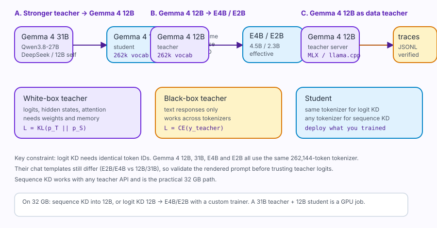

# 39 — Gemma 4 12B distillation: the landscape

*Last verified: 25 October 2026. Model IDs, tokenizer hashes and template hashes were checked against the Hugging Face repositories on that date; training and memory numbers are estimates, not measurements.*

This chapter is the map. It explains what distillation actually does, which direction makes sense for Gemma 4 12B, what fits in 32 GB, and what you should expect to gain — and not gain.

The practical chapters are:

- [40 — Teachers, students and data](40-distill-data.md)
- [41 — Distillation training](41-distill-training.md)
- [42 — Distillation evaluation](42-distill-eval.md)

---

## 1. The one-paragraph answer

**On a 32 GB Mac, the practical route is sequence-level distillation into Gemma 4 12B**: collect high-quality teacher traces from Gemma 4 31B, Qwen3.8-27B or DeepSeek, then train a 12B LoRA on those traces with MLX. **Logit distillation is the better transfer method but needs a custom trainer and more memory**: a 31B teacher plus a 12B student does not fit comfortably in 32 GB. If your goal is cheap deployment, **distill Gemma 4 12B into E4B or E2B**; they share the exact tokenizer, so logit KD is possible on a rented GPU.

---

## 2. What distillation is

A teacher model \(T\) and a student model \(S\) see the same input \(x\). The teacher produces a distribution over the next token:

\[
p_T(y\mid x)=\operatorname{softmax}\left(\frac{z_T(x)}{T_{\text{temp}}}\right),
\]

where \(z_T\) are the teacher logits and \(T_{\text{temp}}\) is a **temperature** (not the teacher model). The student produces \(p_S(y\mid x)\).

### 2.1 Logit distillation

The classic Hinton objective is

\[
\boxed{
\mathcal{L}=(1-\alpha)\,\mathcal{L}_{\text{CE}}
+\alpha\,T_{\text{temp}}^2\,
\operatorname{KL}\left(p_T^{T_{\text{temp}}}\;\|\;p_S^{T_{\text{temp}}}\right)
}
\]

where \(\mathcal{L}_{\text{CE}}\) is the normal next-token cross-entropy on hard labels and \(\alpha\in[0,1]\) controls how much of the signal comes from the teacher.

Why it works:

- The teacher’s **soft labels** contain similarity information: “this token is almost as likely as that one”, “these two API names are confusable”, “this refusal is close to this clarification”.
- Hard labels contain only the single correct token. Soft labels transfer the teacher’s **function**, not just its outputs.
- The \(\operatorname{KL}\) term is a distribution-level loss; it trains the student on every token the teacher considered, not only the sampled one.

The gradient with respect to the student logits is

\[
\frac{\partial \mathcal{L}}{\partial z_S}
=\alpha T_{\text{temp}}\left(p_S^{T_{\text{temp}}}-p_T^{T_{\text{temp}}}\right)
+(1-\alpha)\left(p_S- e_y\right),
\]

where \(e_y\) is the one-hot target. The first term pushes the student toward the teacher’s **ranking**; the second pushes it toward the correct token. This is the entire mechanism. Everything else is engineering: memory, tokenization, data, temperature and evaluation.

### 2.2 Why temperature matters

At \(T_{\text{temp}}=1\), the teacher’s distribution is often extremely peaked; most of the “dark knowledge” is in the tail and is numerically tiny. Raising the temperature softens the distribution:

\[
p_i(T_{\text{temp}})=\frac{\exp(z_i/T_{\text{temp}})}{\sum_j \exp(z_j/T_{\text{temp}})}.
\]

At \(T_{\text{temp}}=2\), differences between logits are halved; at \(T_{\text{temp}}=4\), quartered. The \(T_{\text{temp}}^2\) factor compensates for the gradient magnitude, which shrinks as \(1/T_{\text{temp}}^2\).

Typical settings:

| Setting | Range | Notes |
|---|---|---|
| \(T_{\text{temp}}\) | 1.5–4.0 | 2.0 is a safe default for language models |
| \(\alpha\) | 0.3–0.7 | 0.5 is a safe default; higher if the teacher is much stronger |
| Top-k | 32–128 | sparse soft labels; full vocab is 262k for Gemma 4 |
| Label smoothing | 0.0–0.1 | optional; the teacher already supplies soft targets |

Do not use temperature to “make the teacher more creative”; it changes the target distribution, not the teacher’s knowledge.

### 2.3 Sequence-level distillation

If you cannot access teacher logits — because the teacher is behind an API, or you do not want to run both models at once — use **sequence-level distillation**:

\[
\mathcal{L}_{\text{seq}}
=-\sum_{t\in\text{response}}
\log p_S(y_t\mid y_{<t},x),
\qquad
y\sim p_T(\cdot\mid x).
\]

The teacher generates the response \(y\); the student is trained on it with ordinary SFT. This is also called **behavior cloning** or **data distillation**. It transfers:

- answer style and format;
- reasoning traces;
- tool-call syntax;
- refusals and scope language;
- the teacher’s typical solution path.

It does **not** transfer:

- the full token distribution;
- uncertainty/calibration;
- the teacher’s knowledge beyond the sampled response;
- behaviour on states the teacher never visited.

Sequence KD is cheap, robust and supported by MLX-LM today. It is the default on a 32 GB Mac.

### 2.4 On-policy distillation

Sequence KD trains on teacher states. At inference, the student visits **its own** states, including its own mistakes. On-policy distillation closes that gap:

1. the student generates a rollout \(\hat y\sim p_S\);
2. the teacher scores, corrects or continues the rollout;
3. the student is trained on the corrected sequence;
4. repeat.

The objective is

\[
\mathcal{L}_{\text{on-policy}}
=-\sum_t \log p_S(y_t\mid \hat y_{<t},x),
\]

where \(\hat y_{<t}\) are student-generated prefixes and \(y_t\) is the teacher’s preferred token or correction. This is DAgger-style imitation. It is more expensive because it needs teacher inference during training, but it fixes exposure bias and is especially useful for agentic tool use.

### 2.5 Feature distillation

Instead of matching output distributions, match hidden states:

\[
\mathcal{L}_{\text{feat}}
=\sum_{l\in\mathcal{L}}
\left\|h_S^l-W_l h_T^l\right\|_2^2,
\]

where \(W_l\) projects the teacher’s hidden size to the student’s. This requires white-box access to both models, aligned layers, and a projection; it is rarely the first thing to try for a decoder-only LLM. It can help when the student is much smaller and logit KD is too weak.

### 2.6 Self-distillation

The teacher and student are the same model family, often the same checkpoint:

- teacher = Gemma 4 12B with thinking enabled, or best-of-\(n\);
- student = Gemma 4 12B with a LoRA adapter trained on the teacher’s traces.

This transfers **more compute at training time** into **less compute at inference**: the teacher can sample 8 candidates and keep the best; the student learns the winning path. It is cheap on 32 GB because you only run one model at a time. It cannot add knowledge the model does not already have.

---

## 3. Three directions for Gemma 4 12B

“Distilling Gemma 12B” can mean three different projects. They have different costs and different code.



### Direction A — a stronger teacher → Gemma 4 12B

**Goal:** make the 12B behave like a 31B / Qwen3.8-27B / DeepSeek on your domain.

| Teacher | Tokenizer | Local teacher? | Best method |
|---|---|---|---|
| **Gemma 4 31B** | Same 262k tokenizer | 4-bit ~17 GB; 32 GB is tight with a 12B student | Logit KD on 80 GB; sequence KD locally |
| **Qwen3.8-27B** | Different tokenizer | 4-bit ~15 GB | Sequence KD only |
| **DeepSeek V4.1 Flash / V4-Pro** | API | No local weights | Sequence KD / on-policy |
| **Gemma 4 12B (thinking)** | Same | Yes | Self-distillation / best-of-\(n\) |

**What you get:** domain style, reasoning traces, tool format, refusals. **What you do not get:** a 12B that is generally as capable as a 31B. Distillation compresses behaviour on the training distribution; it does not compress all of the teacher’s knowledge.

### Direction B — Gemma 4 12B → E4B / E2B

**Goal:** a 4.5B-effective or 2.3B-effective model that runs on a laptop or phone and keeps most of the 12B’s domain behaviour.

This is the **best white-box distillation project** in the family because:

- all Gemma 4 models share the **same 262,144-token tokenizer** (SHA-256 prefix `631271cd489aa7d0` for 12B, E4B, E2B and 31B on 25 Oct 2026);
- E4B and E2B are Apache-2.0;
- E4B is ~8.0B total / 4.5B effective; E2B is ~5.1B total / 2.3B effective;
- the 12B teacher is only ~7.65 GB at 4-bit and the E4B student ~4.0 GB, so **both fit in 32 GB** at short context;
- logit KD is meaningful because the vocabulary is identical.

Caveat: the **chat templates differ**. On 25 Oct 2026, E2B/E4B templates hash to `0a2c8073c878ab1d`, while 12B/31B hash to `ae53464bf3be2580`. The E4B template does not insert an empty thought block when thinking is disabled; the 12B/31B template does. Same tokenizer is necessary for logit KD, not sufficient; render and align the prompt carefully.

### Direction C — Gemma 4 12B as the teacher

**Goal:** use the 12B to generate data for any smaller student, including Qwen, Llama or Gemma E2B/E4B.

This is the cheapest and most flexible route:

- run `mlx_lm.server` with the 12B on the Mac;
- generate thousands of traces;
- filter and verify;
- train any student with SFT (sequence KD) or logit KD (if tokenizer-compatible).

It is also the weakest teacher of the three options, because the 12B is smaller than 31B/DeepSeek. Use it when cost, privacy or offline operation matters more than peak quality.

---

## 4. Tokenizer and template compatibility

Logit KD requires the teacher and student to produce logits over the **same token IDs**. This is a hard constraint.

Checked on 25 October 2026:

| Model | Vocab | Tokenizer SHA-256 prefix | Chat template SHA-256 prefix |
|---|---:|---|---|
| Gemma 4 12B IT | 262,144 | `631271cd489aa7d0` | `ae53464bf3be2580` |
| Gemma 4 31B IT | 262,144 | `631271cd489aa7d0` | `ae53464bf3be2580` |
| Gemma 4 E4B IT | 262,144 | `631271cd489aa7d0` | `0a2c8073c878ab1d` |
| Gemma 4 E2B IT | 262,144 | `631271cd489aa7d0` | `0a2c8073c878ab1d` |
| Qwen3-14B | 151,936 | different | different |

Consequences:

- **Gemma 4 → Gemma 4:** logit KD possible; use the student’s template for the student and the teacher’s template for the teacher, or validate a shared plain-text format.
- **Qwen → Gemma:** sequence KD only; logits are over different vocabularies.
- **DeepSeek → Gemma:** sequence KD only; the API does not expose logits.

### 4.1 The template trap

A tokenizer maps text to IDs; a **chat template** maps roles and messages to text before tokenization. Two models can share a tokenizer but render the same conversation differently:

```text
E2B/E4B, thinking off:  <|turn>model\n ... <turn|>
12B/31B, thinking off:  <|turn>model\n<|channel>thought\n<channel|> ... <turn|>
```

If you train a student on the teacher’s rendered text, you teach the wrong control tokens. If you run logit KD with mismatched templates, the teacher sees a prompt distribution it was not trained on, and its soft labels are less useful.

**Rule:** render with the **student’s** template for training data; for logit KD, run a small alignment check:

1. render the same prompt with both templates;
2. tokenize;
3. compare the common prefix and the first divergence;
4. if they diverge before the answer, use the student template for both, or restrict KD to the response span after a shared prompt;
5. evaluate teacher-student agreement before scaling.

---

## 5. Memory: what fits

Approximate weights:

| Model | Params | bf16 weights | 4-bit weights |
|---|---:|---:|---:|
| Gemma 4 31B | 31.3B | 62.5 GB | ~17.0 GB |
| Gemma 4 12B | 12.0B | 24.0 GB | ~7.65 GB |
| Gemma 4 E4B | 8.0B total / 4.5B effective | 16.0 GB | ~4.0 GB |
| Gemma 4 E2B | 5.1B total / 2.3B effective | 10.2 GB | ~2.6 GB |

### 5.1 Teacher + student

| Pair | 4-bit both | bf16 both | 32 GB Mac | 80 GB GPU |
|---|---:|---:|---|---|
| 31B → 12B | ~24.7 GB | ~86.5 GB | **No** (activations + logits) | **Yes**, short seq, top-k |
| 31B → E4B | ~21.0 GB | ~78.5 GB | **Borderline** | Yes |
| 12B → 12B (self) | ~15.3 GB | ~48.0 GB | **Yes**, short seq | Yes |
| 12B → E4B | ~11.7 GB | ~40.0 GB | **Yes**, comfortable | Yes |
| 12B → E2B | ~10.3 GB | ~34.2 GB | **Yes** | Yes |

These are **weights only**. Add:

- activations: \(LBTd\) plus attention scores;
- teacher logits: \(B\cdot T\cdot V\) per model;
- top-k buffers;
- optimizer state (for the student adapters only, if LoRA);
- the KV cache if you generate on-policy.

For Gemma’s \(V=262{,}144\), a full logits tensor at \(B=1,T=2048\) is

\[
1\cdot2048\cdot262{,}144\cdot2\ \text{bytes}\approx1.07\ \text{GB}
\]

in fp16, per model, before softmax. Top-k 64 reduces the **stored** teacher signal to

\[
2048\cdot64\cdot(2+4)\ \text{bytes}\approx0.79\ \text{MB}
\]

if you store indices and probabilities, or keeps the on-device gather small. This is why the reference trainer defaults to `--top-k 64`.

### 5.2 The 32 GB verdict

- **Sequence KD into 12B:** yes. Only the student is loaded during training; teacher traces are generated beforehand.
- **Logit KD 12B → E4B/E2B:** possible with a custom trainer at short context; MLX-LM does not implement it.
- **Logit KD 31B → 12B:** not comfortable on 32 GB. Use sequence KD locally or rent an 80 GB GPU.
- **Full fine-tuning** of 12B with a 31B teacher: not a 32 GB project.

---

## 6. What distillation can and cannot do

### Can

- transfer a stronger model’s **answer style**, reasoning format, refusal language and tool syntax;
- improve a smaller model on a **narrow domain** with far less data than pretraining;
- compress a best-of-\(n\) or thinking-heavy teacher into a cheaper student;
- improve calibration and reduce overconfident wrong answers when soft labels are used;
- create a deployable E4B/E2B that behaves like the 12B on your tasks.

### Cannot

- add knowledge the teacher does not have;
- make a 12B generally as capable as a 31B;
- fix a bad teacher or contaminated data;
- replace evaluation on your own tasks;
- guarantee safety — a distilled model can reproduce the teacher’s unsafe behaviour;
- transfer tool use if the student never sees valid tool-call states.

### The honest expectation

On a narrow, well-specified domain, sequence KD from a strong teacher can move a 12B close to the teacher’s **behaviour** on that distribution. On broad benchmarks, the gap remains. Measure both:

- **domain gain** vs the base student;
- **general regression** vs the base student;
- **teacher gap** on the same golden set.

If the student beats the teacher on your set, suspect leakage or an evaluation bug before celebrating.

---

## 7. Decision guide

| Situation | Recommended route |
|---|---|
| 32 GB Mac, want a better 12B on Kali/Java/React | **Sequence KD**: teacher traces → 12B LoRA (MLX) |
| 32 GB Mac, want a cheap deployable model | **Sequence KD** 12B → E4B/E2B (MLX), or rent a GPU for logit KD |
| 80 GB GPU, same tokenizer | **Logit KD** 12B → E4B/E2B, top-k 64, T=2, α=0.5 |
| 2×80 GB, 31B → 12B | **Logit KD** with teacher on the second GPU; sequence KD as baseline |
| No GPUs, no API budget | **Self-distillation** with thinking/best-of-\(n\), then LoRA |
| Need data for Qwen/Llama too | **12B as teacher**, sequence KD only |
| Need maximum quality | Use the teacher directly; distillation is a deployment compromise |

---

## 8. What happens on disk

A sequence-KD run produces:

```text
data/distill/raw/                 teacher outputs (one JSONL per teacher)
data/distill/12b/interim/         normalized, filtered, deduplicated
data/distill/12b/processed/       train.jsonl, valid.jsonl, test.jsonl
adapters/gemma4-12b-distill/      LoRA adapter + config
fused/gemma4-12b-distill-4bit/    optional fused model
reports/distill-eval.jsonl        side-by-side evaluation
```

A logit-KD run produces the same plus:

```text
data/distill/logits/              optional cached top-k logits (offline KD)
adapters/gemma4-e4b-distill/      student adapter
reports/distill-config.json       teacher, student, T, alpha, top-k, hashes
```

The next chapter defines the data contract in detail.

---

## 9. Sources

- Distilling the Knowledge in a Neural Network — <https://arxiv.org/abs/1503.02531>
- Sequence-Level Knowledge Distillation — <https://arxiv.org/abs/1606.07947>
- Born-Again Neural Networks — <https://arxiv.org/abs/1805.04770>
- On-policy distillation / DAgger — <https://arxiv.org/abs/1011.0686>
- Gemma 4 technical report — <https://arxiv.org/abs/2607.02770>
- Gemma 4 12B model card — <https://huggingface.co/google/gemma-4-12B-it>
- Gemma 4 E4B model card — <https://huggingface.co/google/gemma-4-E4B-it>
- Gemma 4 E2B model card — <https://huggingface.co/google/gemma-4-E2B-it>
- Gemma 4 31B model card — <https://huggingface.co/google/gemma-4-31B-it>
- Qwen3 technical report — <https://arxiv.org/abs/2505.09388>
- [32 — Mathematics](32-mathematics.md)
- [40 — Teachers, students and data](40-distill-data.md)
- [41 — Distillation training](41-distill-training.md)
- [42 — Distillation evaluation](42-distill-eval.md)
